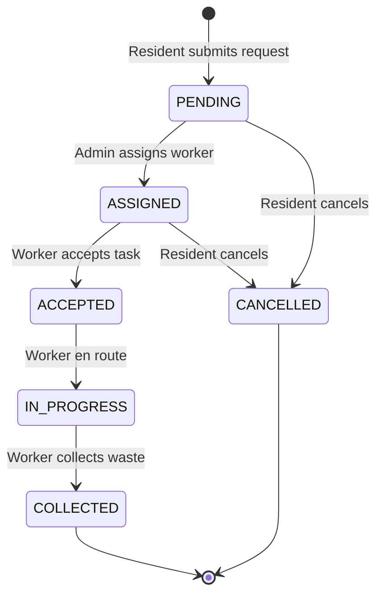

# ♻️ Smart Waste Management and Pickup System

A modern, full-stack enterprise web application designed to streamline urban waste collection operations by connecting **Residents**, **Waste Collection Workers**, and **Municipal Administrators** into a transparent, real-time platform.

Built with **Spring Boot 3 (Java 21)**, **MySQL 8.0**, and **React 19 (Vite)** with an eco-conscious UI/UX design.

---

## 🌐 Live Deployments & Repository Links

- **🚀 Live Web Application (Vercel):** [https://smart-waste-liard.vercel.app](https://smart-waste-liard.vercel.app)
- **⚙️ Live Backend REST API (Render):** [https://waste-management-cxsv.onrender.com](https://waste-management-cxsv.onrender.com)
- **📖 Live Swagger / OpenAPI Documentation:** [https://waste-management-cxsv.onrender.com/swagger-ui/index.html](https://waste-management-cxsv.onrender.com/swagger-ui/index.html)

### 📁 Dedicated Repositories:
- **Frontend Repository:** [https://github.com/Srivaninarmeta/waste_management_frontend](https://github.com/Srivaninarmeta/waste_management_frontend)
- **Backend Repository:** [https://github.com/Srivaninarmeta/waste_management_backend](https://github.com/Srivaninarmeta/waste_management_backend)
- **Monorepo / Full Project:** [https://github.com/Srivaninarmeta/waste_management](https://github.com/Srivaninarmeta/waste_management)

---

## 🌟 Key Features by Role

### 🏡 Resident Portal
- **Secure Authentication:** Register as a new resident or log in with JWT authentication.
- **Submit Pickup Requests:** Choose from 6 waste categories (*General*, *Recyclable*, *Organic*, *E-Waste*, *Hazardous*, *Construction Debris*), specify pickup address, locality, preferred pickup date, and notes.
- **Real-Time Request Tracking:** Visual lifecycle status progress bar (*PENDING* ➔ *ASSIGNED* ➔ *ACCEPTED* ➔ *IN_PROGRESS* ➔ *COLLECTED*).
- **Audit Timeline:** View who acted on each request, at what timestamp, and with what remarks.
- **Request Management:** Cancel uncollected requests or edit pending requests.
- **Personal Profile:** Update contact details, address, or change password.

### 🚛 Collection Worker Portal
- **Task Dashboard:** View assigned pickup jobs filtered by status.
- **Task Execution Flow:**
  - `Accept`: Worker acknowledges the task.
  - `Start Collection`: Worker marks task in-progress while traveling to location.
  - `Mark as Collected`: Worker confirms waste collection with notes.
- **Collection History:** Review previously completed pickups with timestamps.
- **Performance Metrics:** Real-time stats on completed pickups and active tasks.

### 👑 Administrator Operations Hub
- **Executive Dashboard:** Live metrics for total requests, pending, in-progress, completed, active workers, and residents.
- **Worker Assignment:** Assign unassigned pickup requests to active sanitation workers.
- **User Directory:** Manage resident and worker accounts, create new worker profiles, toggle account active status.
- **Analytics & Reports:** Date-range reports, waste category distribution, locality breakdown, and worker performance summaries.
- **CSV Export:** One-click download of pickup audit logs for municipal records.

---

## 🛠️ Technology Stack

| Layer | Technologies |
|---|---|
| **Frontend** | React 19, Vite 8, React Router v7, Bootstrap 5, Lucide Icons, Axios |
| **Backend** | Spring Boot 3.3.4, Java 21, Spring Security (JWT), Spring Data JPA |
| **Database** | MySQL 8.0, Hibernate ORM, Automated Schema Generation & Data Seeding |
| **Documentation** | Swagger / OpenAPI 3 (`/swagger-ui.html`), Actuator |

---

## 🎯 Pre-Seeded Demo Accounts

The application automatically seeds demonstration accounts upon first launch:

| Role | Email | Password | Pre-populated Features |
|---|---|---|---|
| **Admin** | `admin@waste.com` | `admin123` | Full administrative dashboard, worker management |
| **Worker 1** | `worker@waste.com` | `worker123` | Active assigned collection tasks |
| **Worker 2** | `worker2@waste.com` | `worker123` | Available for assignment |
| **Resident 1** | `resident@waste.com` | `resident123` | Existing historical pickup requests |
| **Resident 2** | `resident2@waste.com` | `resident123` | Secondary resident account |

> 💡 **Quick Fill:** The Login page includes one-click **Autofill Buttons** for instant demo access during presentations!

---

## 🚀 Running the Project

### 1. Prerequisites
- **Java 21 (JDK)**
- **Node.js 18+** & npm
- **MySQL Server 8.0** (running on port 3306)

### 2. Database Configuration
Ensure MySQL service is running. Database configuration is defined in `backend/src/main/resources/application.properties`:
```properties
spring.datasource.url=jdbc:mysql://localhost:3306/waste_management_db?createDatabaseIfNotExist=true&useSSL=false&serverTimezone=UTC
spring.datasource.username=root
spring.datasource.password=srivani
```

### 3. Start Backend (Port 8080)
```powershell
cd backend
mvn spring-boot:run
```
- API Base: `http://localhost:8080/api`
- Swagger Documentation: `http://localhost:8080/swagger-ui/index.html`

### 4. Start Frontend (Port 5173)
```powershell
cd frontend
npm install
npm run dev
```
- Access application: `http://localhost:5173/`

---

## 🔄 Waste Request State Machine



---


## 📁 Project Directory Structure

```
Waste_Management/
├── backend/
│   ├── src/main/java/com/smartwaste/
│   │   ├── config/          # Security, CORS, Swagger configs
│   │   ├── controller/      # Auth, Admin, Worker, Resident controllers
│   │   ├── dto/             # Request & Response DTO objects
│   │   ├── entity/          # JPA entities (User, PickupRequest, StatusHistory)
│   │   ├── exception/       # Global exception handling & custom errors
│   │   ├── repository/      # Spring Data JPA repositories
│   │   ├── security/        # JWT token provider, filter & UserPrincipal
│   │   ├── seed/            # Automated demonstration DataSeeder
│   │   └── service/         # Business logic services
│   └── src/main/resources/  # application.properties
├── frontend/
│   ├── src/
│   │   ├── components/      # Common UI components (Navbar, Sidebar, Badges)
│   │   ├── context/         # AuthContext with token state
│   │   ├── layouts/         # DashboardLayout and PublicLayout
│   │   ├── pages/
│   │   │   ├── admin/       # Admin dashboard, requests, users, reports
│   │   │   ├── resident/    # Resident dashboard, create pickup, tracking
│   │   │   ├── worker/      # Worker dashboard, tasks, history
│   │   │   └── public/      # Home, About, Login, Register
│   │   ├── services/        # Axios API integration
│   │   ├── App.jsx          # Route configuration
│   │   └── index.css        # Eco design system & styling
```

---

## 🚀 Production Deployment

Comprehensive deployment configurations and guides are provided in [DEPLOYMENT.md](file:///c:/Users/sriva/OneDrive/Desktop/Waste_Management/DEPLOYMENT.md):

1. **Unified Single JAR (Zero CORS):** Run `build_production.bat` to create a standalone fat JAR containing both React UI and Spring Boot API, then run `java -jar backend/target/backend-1.0.0.jar`.
2. **Docker Compose:** Run `docker compose up -d --build` for isolated MySQL, Spring Boot, and Nginx containers.
3. **Free Cloud Deployment:** Step-by-step instructions for hosting on Render, TiDB Cloud, and Vercel.
